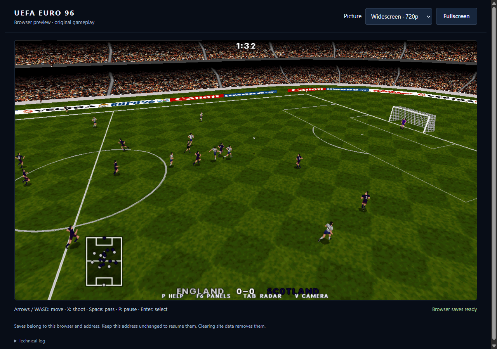
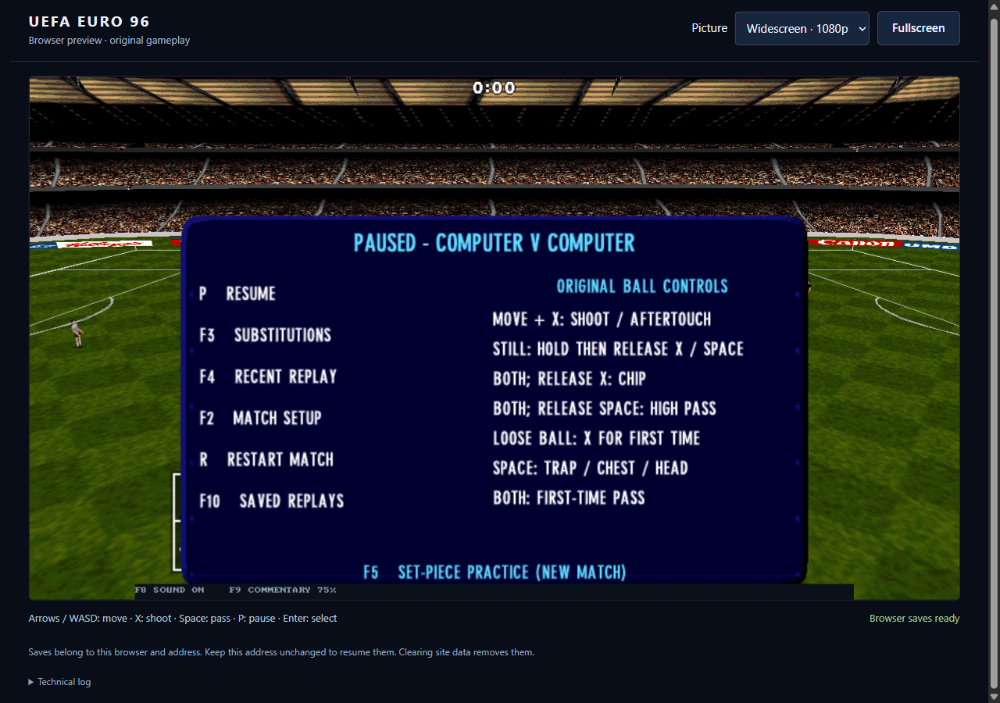

# Enhanced presentation preview

This work lives on `browser-proof`. The Windows restoration tag `v0.70.0-final`
still points to `a2e7cdd`; the stable playtest manifest and launcher are unchanged.

## Try it

- Browser: reload the local preview when ready, then choose **Picture**:
  **Widescreen 720p** (default), **Widescreen 1080p**, or **Classic**.
  Changes apply during play. Fullscreen uses the screen's actual aspect ratio.
- Windows: use the separate `Play-Euro96-Enhanced.cmd` launcher beside the
  existing stable launcher. **F12** cycles Classic / 720p / 1080p; **F11** toggles
  fullscreen. `tools/play_enhanced.ps1 -Picture 1080` starts the higher preset.
- From a fresh checkout, build the normal Release target, then pass its path to
  `tools/play_enhanced.ps1 -Executable <path-to-actua96.exe>`. The staged local
  launcher expects `../Euro96-Enhanced/actua96.exe` and the matching SDL3.dll.
  Original game data and imported retail media remain required.

The preview shares the existing save format and Windows save directory. Its
executable is separate from the final release. Neither launcher closes another
running game.

## What changed

1. Browser rendering now follows requestAnimationFrame. A small owned C++
   coroutine retains the application's locals and copied argv across callbacks;
   native builds use the same frame body. Audio initializes in the launch click.
   Gameplay continues on its original fixed 20 Hz clock.
2. Adjacent polygons using the same texture are submitted together. Texture
   changes, lines, and sprites flush the batch, preserving painter order and
   transparency. Small faces no longer allocate a vertex vector individually.
3. Widescreen expands the horizontal camera view while preserving vertical
   field of view. Players and pitch markings are projected at the selected
   resolution; this is not a stretched 640x480 match image.
4. The original CPU ground/sky renderer supports the selected projection size.
   At 16:9, the presets use 1280x720 or 1920x1080 coordinates. The output then
   fits the actual window/canvas. The geometry retains the original models and
   texture detail: these are not replacement HD assets.
5. The HUD retains its proportions and aligns with the original menu safe area.
   Picture changes and fullscreen changes resize SDL's browser drawing buffer.
   Original menu screens and views containing management panels retain their
   existing layout. Classic remains available for comparison.

## Validation (2026-10-16)

- Full Windows build succeeded. Twelve focused CTest contracts passed: graphics,
  scene composition, environment, player materials, frontend, startup, save
  directory, replay files, tunnel exits, prematch, walkoff, and enhanced display.
- The new display contract covers coroutine lifetime/destruction/exceptions,
  640x480, 1280x720, 1920x1080 and 2520x1080 environment buffers, camera target
  preservation, an exact return to Classic ground pixels, and all five cameras
  after advancing their state. The strengthened camera test was rerun and passed.
- The staged Windows executable passed startup at 720p and replay-file smoke
  at 1080p, including replay seek, camera changes, controller events and return.
- All four WebAssembly gameplay suites passed: 72,185 ball checks, automatic
  selection, twelve CPU matches and twelve human penalty shootouts.
- Separate Chromium QA verified live mode switching with matching CSS/backing
  buffer dimensions, fullscreen, pause/resume, original menu startup, IndexedDB
  preferences surviving reload, and normal program exit. Actual audio samples
  were nonzero (observed peak 0.710). No browser error was reported; SDL's audio
  backend still produces Chromium's ScriptProcessorNode deprecation warning.
- Short foreground samples on this machine yielded approximately 144 fps in
  Classic, 100 fps at 720p, and 52 fps at 1080p. These are different live match
  intervals, not a controlled benchmark or guaranteed minimum. Simulation
  remained near 20 ticks/sec. Background tabs suspend/throttle browser frames.
- Wasm size: 2,293,684 bytes; loader: 255,623 bytes. Asset payload is unchanged.

## Next graphics work

The CPU ground raster is the main scaling cost; a GPU implementation would make
higher resolutions less expensive. Texture filtering/edge antialiasing and a
carefully matched replacement texture pack can follow without changing game
logic. This batch deliberately retains the original artwork. Sustained browser
performance, other browsers and physical gamepads still need broader testing.
