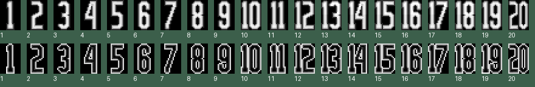

# Retail shirt numbers 1-20 recovered

Follow-up inspection corrected the earlier conclusion that shirt-number artwork 16-20 was absent. That conclusion examined retail EUROREND record 107, which is identical to the older preserved 1-15 atlas, but did not follow the retail revision's changed number texture coordinates.

The pinned retail EUROREND archive's **record 38** contains complete precomposed numbers **1-20**, with light and dark variants. Retail UV record 1 supplies twenty consecutive rectangles per variant:

- Texture IDs 533-552: light numbers 1-20 on texture page 6.
- Texture IDs 553-572: dark numbers 1-20 on texture page 6.
- Numbers 1-15 use rows 181-205 and 206-230 respectively.
- Numbers 16-20 use rows 231-255, columns 0-84 for light and 85-169 for dark.

The image below was extracted directly from retail record 38 using those UV rectangles and the retail record-0 palette, with nearest-neighbour enlargement. The labels underneath were added for inspection. The black background is a display background; runtime transparency still needs to follow the retail rasterizer's index convention.

This is evidence of precomposed numbers, not evidence of a runtime tens/units compositor. It establishes that replacement artwork is unnecessary. The 0.54.0 adapter still binds the older number table and suppresses numbers above 15. The subsequent [0.54.1 implementation](SHIRT-NUMBERS.md) imports the retail atlas/UVs, validates transparency and variant selection, and binds all twenty shirt identities without disturbing the extra-page markers/flags or keeper materials.

No game executable or published snapshot changed during this investigation. Existing claims that the disc lacks 16-20 artwork are superseded by this finding.
