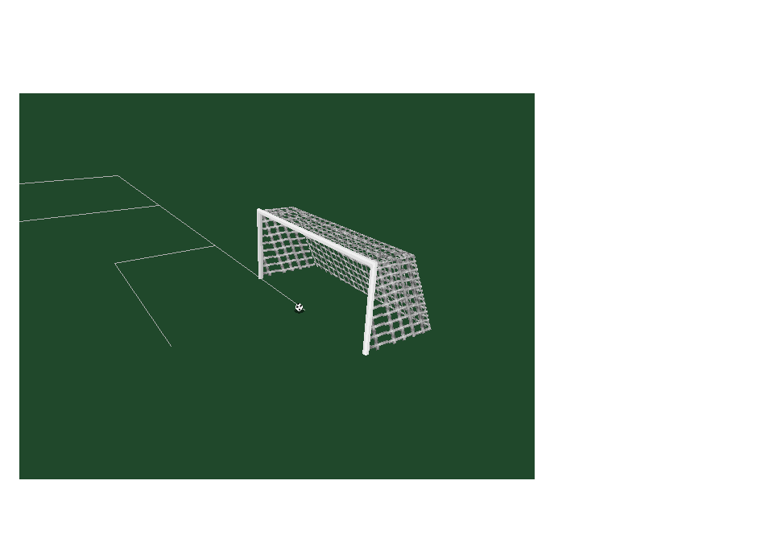

# Original goal collisions - 0.16.0

The action sequence now runs the original BALL.CPP collision path immediately
after free-ball trajectory updates, in the order used by process_ball. A shot
that beats the keeper continues for three seconds through the goal and net
response instead of stopping at the goal line.

One review covers five cases: **post**, **crossbar**, **outside side net**,
**roof of the net**, and **goal / back net**. Open the existing original-view
launcher and press **G**. Each case has a one-second lead-in and three seconds
of original physics. **H** repeats the batch at the other end. **P** pauses,
**Up/Down** rotates the camera, and **Space** returns to the attack / keeper
sequence. **N** shows the attacking header beating the keeper and entering
the net. The preview also supports `--goal-review`.

## Recovered behavior

Sixteen complete original routines are extracted from BALL.CPP without changing
their algorithms: shot_passed, rebound_post, rebound_bar, hit_goal_post,
hit_cross_bar, hit_high_side_net, hit_low_side_net, hit_top_net,
hit_inside_back_net, hit_inside_back_net_r, hit_inside_top_net,
hit_inside_high_side, hit_inside_low_side, outside_of_net, is_it_a_goal and
ball_collision. The existing af_randomize, trajectory and shot-reset routines
remain in use. Function scope is adapted to PlayerEngine.

Post impacts keep vertical velocity and redirect horizontal motion with the
original 0.8 speed multiplier. Crossbar impacts redirect horizontal and vertical
motion. Net contacts use the original half-speed responses, spin clearing and
position clamps. Goal detection interpolates the crossing point and uses the
original strict mouth bounds; it does not introduce a new whole-ball rule.

The missing REBOUND_FACTOR is recovered from pinned BALL.OBJ CONST+0x124,
with the identical crossbar value checked at +0x13c. Exact fmul instruction
bytes are checked at _TEXT+0x1751 and +0x1876. Commentary IDs 34/35 are recovered
and instruction-checked at +0x179a and +0x19ba. These requests reach the existing
audio-event boundary; playback still needs the missing sample archive/backend.
The generated player recovery report records routine hashes and constant evidence.

## Native preview boundaries

The five launches, review timing, camera and switching controls are diagnostic
inputs, not recovered match AI or player kicking input. The routines determine
all collision outcomes. The bar launch is aimed using the original trajectory;
its collision is detected normally. The default attack retains its original
pass / chip / header actions and now uses the same collision path.

The original go_left_goal / go_right_goal scoring dispatchers are **not**
restored. Explicit preview callbacks latch ball_in_goal, record one goal event
and its end, and reset shot state. They do not update match scores, scorer
statistics, own-goal attribution, celebrations, menus or restarts. Those systems
remain unfinished. Scored balls bypass player interaction while the net settles.
The two-versus-two practice adapter is unchanged.

Original random calls use the host C runtime, as in the existing recovered
actions. Tests verify response properties; this is not a claim of bit-exact
Watcom random sequences or floating-point parity. Original division-by-zero
intermediates in missed/stationary intersection calculations remain unchanged;
the regression includes finite final-state checks. SOURCE is untouched.

## Verification

The goal suite covers both ends, both posts, crossbar speed and direction,
exact mouth edges, high-speed crossing interpolation, high/wide misses,
duplicate-goal suppression, all inner/outer net responses, spin removal,
stationary balls behind the line, pause, all ten rendered launch cases and
automatic batch completion. It checks the attacking header's net rebound and
the unchanged keeper sequence: catch 59, distribution 171, reception 208,
finish 229. The native window smoke injects G and H and completes both batches.

All 32 CTest suites passed in 68.82 seconds. Both the goal close-up and the full
native review screen were visually inspected.

