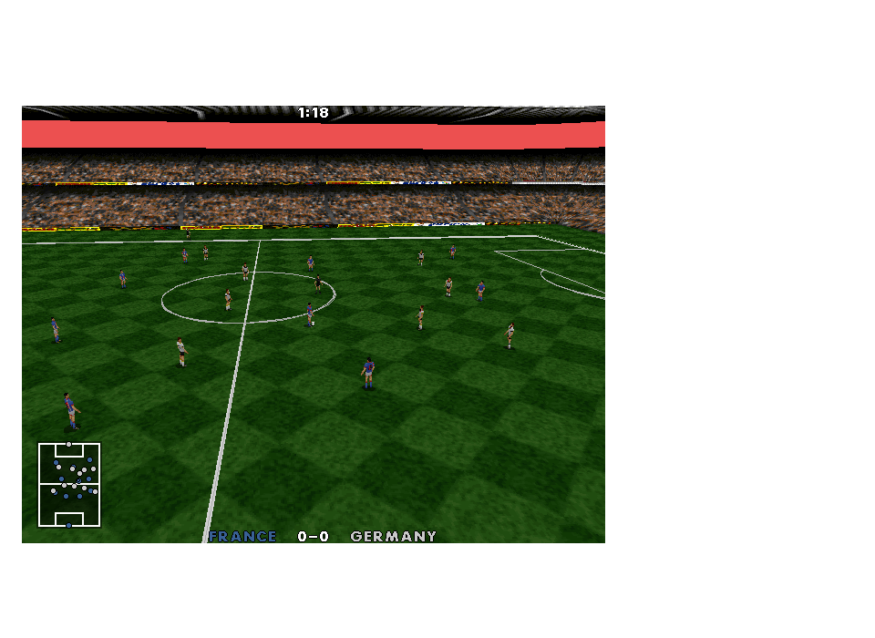
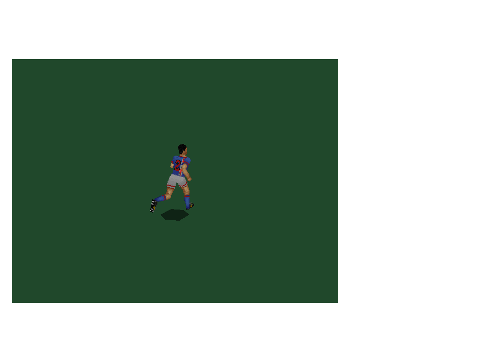
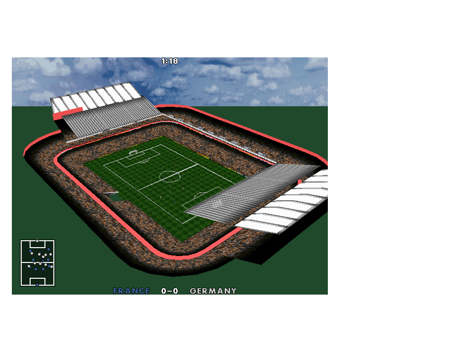
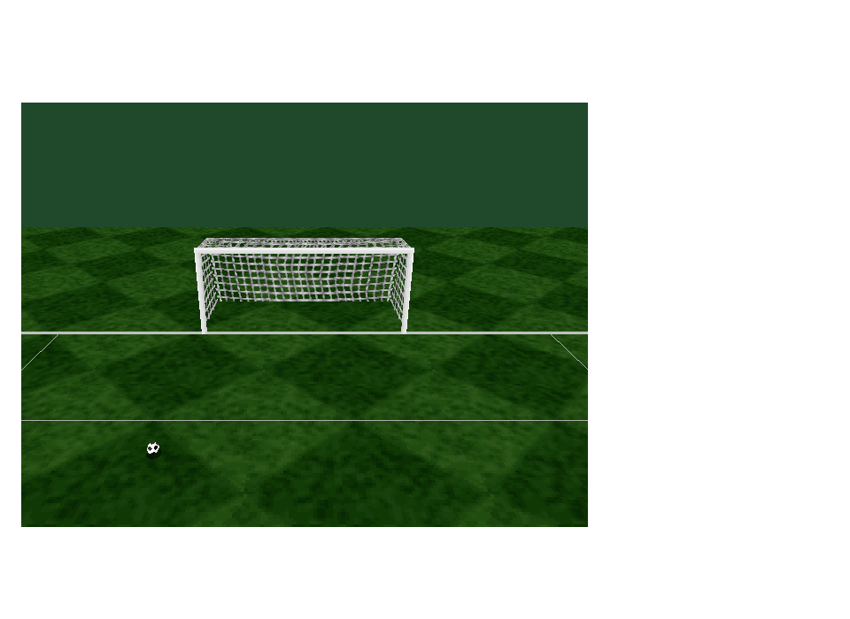

# Original graphics environment - 0.31.0

The five-part batch connects original team textures, detailed ground, sky,
country crowd palettes and the original close-goal clipping path. Open the same
playtest launcher next time. Publishing does not restart an existing match.

## CD country kits and crowd palettes

`tools/import_cd_graphics.py` reads SOCCER.EXE and ACTREND.DAT/OFF directly from
the supplied ISO using 7-Zip; it never executes the DOS program. Inputs are pinned
by SHA-256. The 47 eight-field kit descriptors at EXE file offset 1,255,764 match
all FILES.C descriptor relationships. Country order independently matches the
CD gameplay database. All 128 components in the sixteen preserved source kit
rows match CD records byte for byte.

The importer matches Euro countries by name, not by ordinal team number.
France, Germany, Holland, Portugal, Romania and Czech Republic gain their
original CD uniforms. Eight already available countries retain identical art.
Croatia and Turkey have no matching descriptor on this disc and retain explicitly
labelled substitutes. Automatic kit-clash selection remains pending.

The unchanged head, torso, limb, number and palette records are packaged into
optional local-data/GRAPHICS/TEAMS.BIN. The native reader bounds sizes, validates
identities and palettes, and rejects partial/trailing records. Existing original
page packing, away-colour remapping and shirt-number overlays are retained.
Home/away crowd colours now follow the actual CD team descriptors as well.
This adds country palettes, not crowd animation.

The [machine-readable report](cd-graphics-recovery.json) records every component's
archive index, size and hash. The publisher and launcher verify the pack alongside
other imported media. The Euro archives are not replaced by the CD archives.

## Pitch and sky

Pinned 3DENG.OBJ stadlist and skylist verify Euro pitch bitmap 114, sky bitmap 96
and sky palette 90. The pitch uses the original 64 x 64 high-detail tile at a
256-byte row stride and the existing pitch palette at slot 128. The sky uses the
original 640 x 480 bitmap and palette at slot 208. Metadata is emitted by
restore_graphics.py into the generated graphics data/report.

OriginalEnvironment inverts the original camera matrix onto the ground plane,
with finite horizon checks and stadium bounds. It follows ground()'s three-repeat
sky heading, pitch crop and stadium roof extent. Bounded native pixels and SDL
replace DOS assembly scanlines. This is not a bit-exact DOS rasterizer: it uses
floating-point projection and safe horizontal wrapping. The first supported
original sky variant is selected deterministically without consuming gameplay RNG.
No new grass or sky artwork is generated. Outside the stadium footprint the
existing overview background remains. The red flat stadium rim in this checkpoint was not validated against the finished CD stadium. It is superseded by the complete CD asset set in 0.31.1; see [stadium recovery](STADIUM-RECOVERY.md).

## Goal clipping

Original render3d calls addobjnc for all eight goal components. The Windows path
previously called addobjy, which could discard an entire component once its origin
passed behind the camera. The restored call clips visible net faces at the near
plane, retaining original detail selection and UVs. Existing clipped stadium and
pitch paths remain in use. Player special cylinder/ellipsoid faces retain their
separate original path.

## Verification

The environment contract checks fourteen matching kits, missing-pack fallback,
all shared source components, sixteen country pairs across three cameras, actual
crowd palette values, ground projection and negative wrapping, changing sky
heading, bounded extreme camera angles, stable paused pixels and gameplay RNG
independence. Completed SDL frames are presented before inspecting pixels.
Real goal meshes exercise the case where the old object-origin test discarded
still-visible faces; existing scene contracts cover clipped textured pentagons,
UV scratch bounds and transparent material preservation.

The full original CPU match is rendered periodically and must still finish 1:0
in 7,328 ticks. Captures cover France/Germany, the imported France kit, stadium,
sky/ground and a close goal. See graphics-environment-test-results.txt for the
final regression and publication results.

Final result: all 58 contracts passed; the final optimization also passed six
focused checks. The published 0.31.0 snapshot passed hidden capture/front-end
smoke and launcher media verification. SOURCE has no changes.

