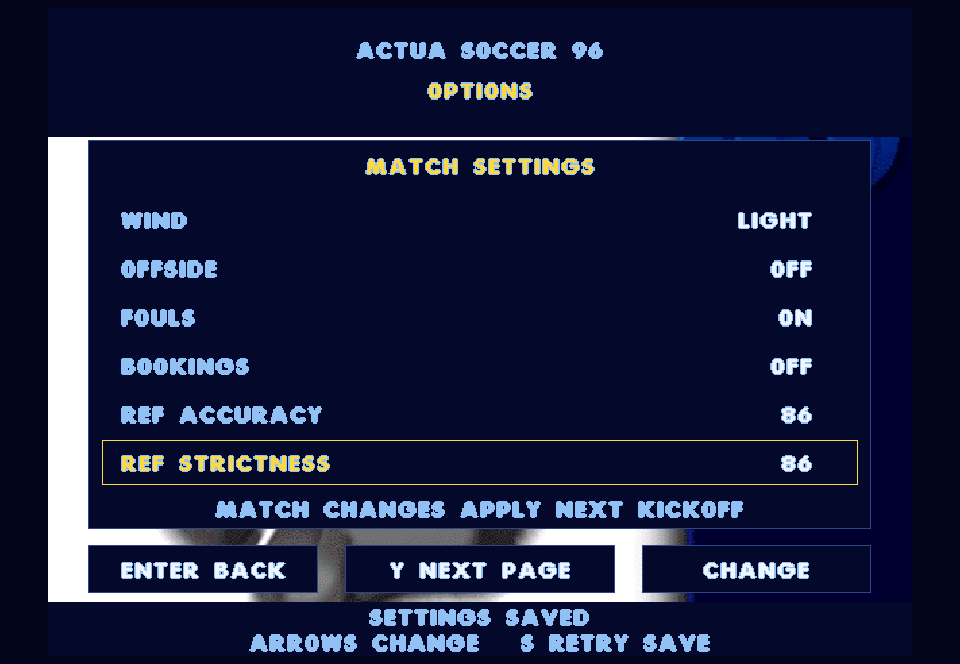
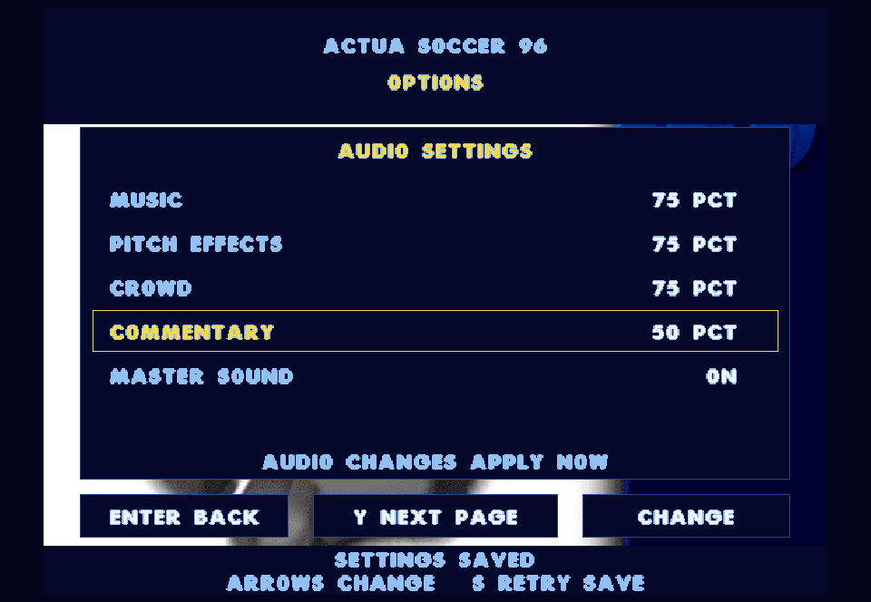

# Match options and saved preferences - 0.37.0

This five-feature batch connects original wind settings, rule switches and referee ratings, adds independent audio levels, and saves preferences between launches.

## Controls

Open the existing Play-Actua96 launcher when ready. Press **O / RB** from the title, match setup, lineup, tournament hub or half-time screen to open Options. In the tactics screen, O also opens Options; RB there still changes the viewed country. During a match, use F2 / L3 to open the match menu first. The simulation stays paused while editing.

**Y / North** switches Match and Audio pages. Up/Down selects a row; Left/Right changes it. **Enter / South**, Esc / East or O / RB returns to the previous screen. Returning from Options does not kick off or resume automatically. Mouse clicks on a row's left/right half decrease/increase its value; the bottom Change button increments the selected value. The options footer opens this screen from the menus; on lineup and half-time, its left half opens Tactics and right half opens Options.

The match page offers Off/Light/Medium/Strong wind, Offside, Fouls, Bookings, Ref Accuracy and Ref Strictness. Changes apply at the **next kickoff**, including the next tournament fixture. The active match retains its original settings through half-time, substitutions and changes of ends. Existing defaults remain wind Off, all three rule switches On, and both referee values 96. These are the restoration's existing defaults, not a claim about the DOS game's default options.

The audio page offers separate Music, Pitch Effects, Crowd and Commentary levels plus Master Sound. Levels change immediately in 25-point steps. F8 remains master mute; F9 cycles commentary volume. These shortcuts now save their values too. Master mute preserves the individual channel levels. Normal pause/focus-loss behavior and commentary ducking remain intact.

## Original behavior and native boundaries

- FOOTBALL.CPP's match initialization sets wind speed to the option times 30: 30, 60 or 90. Its final assignment selects fixed wind in the +X direction, even after the earlier random-variable-wind branch. This adapter uses that final fixed-wind behavior and BALL.CPP's existing ball_friction calculation. It does not add new weather graphics or gust physics. Wind stays in world coordinates when teams swap ends.
- INTELL.CPP's original override gates offside_rule with the offside setting. The native player scheduler now makes that same gate. Original offside exemptions during restarts remain active when enabled.
- RULES.CPP's init_foul checks EUROmatch_info.freekicks, and send_off_plr checks EUROmatch_info.bookings. Disabling fouls also suppresses offside awards because the original offside path goes through init_foul. The settings screen displays this dependency. Turning bookings off keeps foul decisions but suppresses cards.
- FOOTBALL.CPP assigns referee vision and discipline to ref_accuracy and ref_strictness. Options now supply those same fields, used by the original visibility, interference, foul and disciplinary decisions. The native menu exposes values from 0 to 100 with ten-point adjustments; it does not claim to reproduce the historical slider layout.
- Audio events and assets remain original. Native mixer gains separately control pitch voices, crowd reactions/ambience and music. Commentary uses the existing speech gain. Default levels preserve the previous mix. The options pages and persistence format are native SDL/restoration code.

The preserved SOURCE tree is unchanged.

## Persistence and recovery

Preferences are global defaults for subsequent fixtures, independent of the tournament checkpoint. They live in `tournament.prefs` beside `tournament.sav` in SDL's per-user AppData folder (`Actua96 Restoration/Actua96`). Changes save immediately using a checksum, bounded validation, a temporary file and atomic replacement; the preceding valid file is kept as `.bak`.

A corrupt primary loads the valid backup if possible, otherwise defaults, with a visible message on Options. Loading never overwrites the damaged file. A later save retains the valid backup when the primary was corrupt. Save failure leaves the session usable and displays a retry message; S or another setting change retries. Opening menus alone creates no preference file. Automated smoke tests and captures are isolated from production preferences; the production-directory probe uses uniquely named files.

Tournament save version 3 is unchanged. Existing tournament results, conditions, squads, formations and takers remain supported. An unfinished match is still restarted from the preceding checkpoint when reopening the app; new kickoff settings then apply.

## Verification

All 66 regression checks passed in 208.41 seconds. The full 31-match CPU tournament completed with its previous deterministic result (Germany, four extra-time games, three shootouts). Four additional complete CPU matches exercised every wind strength and independent rule settings: offside disabled produced zero offside calls; fouls disabled produced zero foul/offside calls; bookings disabled produced zero cards. Tests also compare wind-induced ball drift and exercise the original referee visibility/interference decisions at different ratings.

Persistence tests cover roundtrip, the preceding valid backup, checksummed invalid-value rejection, recovery without destroying a good backup, visible write failure, keyboard/gamepad/mouse editing, restart reload, exhibition/tournament kickoff, unchanged active-match state and a held CPU half-time countdown. PCM comparisons verify independent pitch, crowd reaction, crowd ambience and music gains, including silence at zero. Integrated executable tests check all audio controls and F8/F9. The --commentary-smoke parser previously selected only the generic frontend test; it now reaches the intended speech/mute assertions as well. Both options pages were visually reviewed using the final build.

Published snapshot `b7251ac2591bae27-2b4b128d-0703f4d7-65e2336c` passed launcher and media hash verification. The exact published executable passed creation, simulation, replacement, backup, reload, resume, next-fixture and preference checks in AppData using unique probe files. The user's tournament save hash was unchanged and no production preferences file was created. The interactive game was not restarted, and SOURCE remains unchanged.

[Full regression results](settings-regression.txt), [settings behavior contracts](settings-contracts.txt), [published executable save/preferences probe](settings-published.txt).

