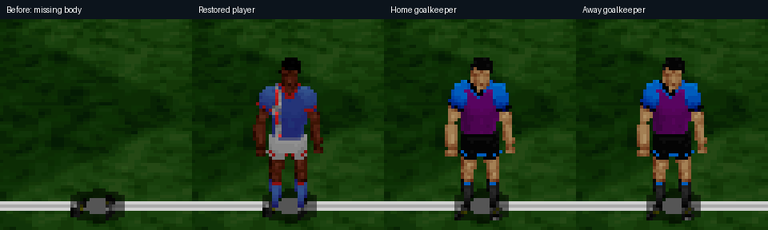

# Player texture-page correction — 0.32.1

The 0.32.0 appearance selection exposed an incomplete native texture loader: original alternate player face tables address pages 10–12, but these were zero-filled. Transparent bodies left the separate page-6 shirt number and page-3 boots visible. The earlier geometry and material-pointer tests did not detect this visual failure.

The loader now follows preserved `3DENG.C` init3d exactly: home/away torsos on pages 10/11, record 38 (BM_XLIMBS) on page 12, with the two team limb strips overlaid before remapping. The head artwork below the limb strips is retained. Skin indices 80–87 become 96–103; away uniform indices 32–55 become 56–79. Only the two 78-row limb strips are remapped, preserving the separately authored heads. The pinned 3DENG.OBJ load at 0x13e46 verifies record 38 and destination page 12. No preserved source or gameplay routines changed.

## Goalkeepers

Both original keeper material sets already load their own torso and limb textures: pages 4/5 for home, 14/13 for away. Record 35 supplies the purple body and blue sleeves visible below. The isolated renders did not reproduce a missing keeper kit, so this patch does not invent different goalkeeper art or claim to fix an unconfirmed keeper defect. Further matchup/visual details from the user remain useful. Keepers retain the original renderer's exception to alternate appearance selection.

## Regression coverage

`original_player_material_contracts` checks actual pixels against the same empty scene, rather than merely counting submitted polygons. Six material cases (home/away normal, alternate and keeper) run in front/back views and normal/mirrored poses. Every case must display a head and a substantial body silhouette. In the pre-fix captures the alternate player changed only 153–204 pixels; restored bodies change 653–684 pixels in the same fixtures. The test additionally isolates every starting roster slot across all 16 home-team selections and both half material bindings (704 renders), checking visible bodies and the keeper jersey's original palette colours.

The fixed-camera roster checks preserve the actual starting roster and half material selection but disable match camera/HUD to make body coverage comparable. They do not claim to simulate halftime transitions; existing match tests cover those.

All 60 CTest checks passed in 237.59 seconds, including the new 704-roster-render test. [Full test results](player-material-test-results.txt). Published snapshot `04eae253a25d6e6d-2b4b128d-0703f4d7-cc179fc1` passed launcher hash verification, an offscreen France/Scotland match capture at tick 180, and the 40-frame front-end smoke check. The running interactive game remains untouched; the stable launcher picks up the update on the next launch.
