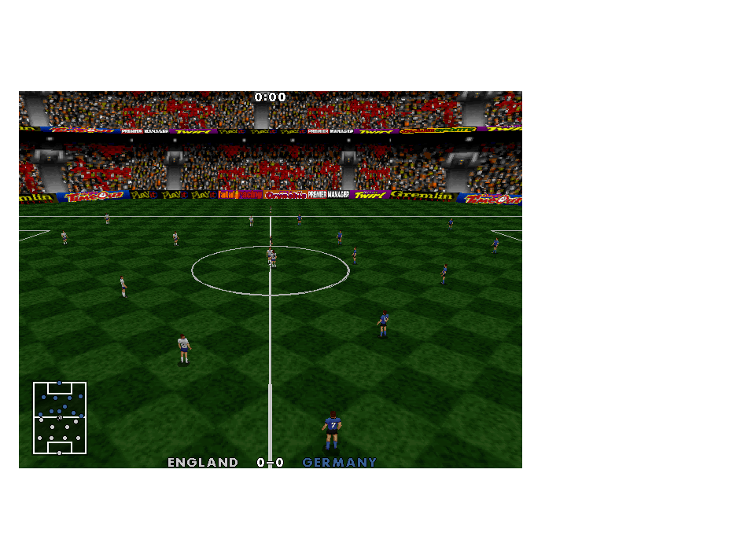
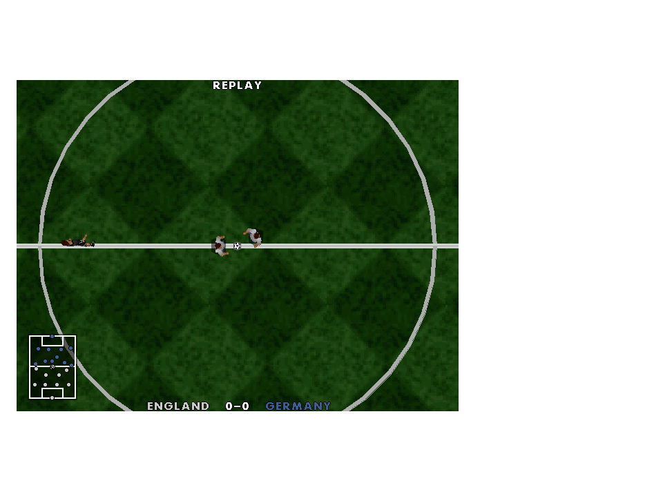
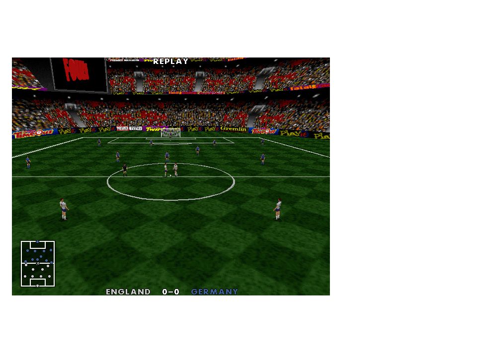

# Original presentation batch - 0.32.0

Five features are integrated into one release. The running interactive game is not restarted; the stable launcher picks up the new snapshot on the next launch.

1. **Stadium video board.** The preserved FAP archive supplies goal, foul, penalty, half-time, full-time and extra-time clips. `3DENG.C` init_anim/do_anim defines the 128x80 literal/skip delta format, looping and frame limits. The CD stadium descriptor locates its screen at byte 1802 in texture page 8. A bounded native decoder and native event counters connect this path, which is disabled by an `if (0)` in the preserved render loop. This is restoration of available original assets/code, not proof that this Euro build displayed them. The default logo in the supplied FAP is VR Soccer. Win/boost clips remain unconnected.
2. **Original kit clashes.** The pinned CD executable contains the 45x45 selection matrix at byte 1108816; 2,024 entries match the older commented GAMEDATA.CPP table. The one differing entry (Saudi Arabia/Germany) follows the CD. CD kit rows 45/46 provide generic white/blue alternates. Only the away torso, limbs, numbers and kit palette change; heads, skin and crowd colours retain their country. All 14 matched countries use the table. Croatia/Turkey remain explicit asset substitutes with no invented clash rules.
3. **Player appearance.** 181 of the 320 Euro roster names have unambiguous initial-plus-surname matches within the same country's original CD squad. The CD player records have 33-byte stride, at team+144, with appearance at byte 32; squad/position/flag fields are validated. Twelve matches carry the alternate appearance flag. These drive DATA.OBJ's original player_f1b/f2b and mirrored face tables, including after halftime and substitutions. Keepers retain the original exception. Unmatched names retain the existing appearance. No hair, face likeness or new nationality-based appearance rules have been invented; these are the CD's authored flags, not independently verified depictions of real people.
4. **Two more original replay cameras.** V or right-stick click cycles Auto, Isometric, Follow, Plan and Goal line during replay. The new camera bodies are extracted from modes 1/2 in 3D_UPD2.CPP, with their original inertia and framing. Per-renderer state replaces shared static variables and native 20 Hz timing replaces DOS timing. Returning from replay restores the live camera and prior pause state. The original code shows user-selectable cameras; there is no claimed automatic cinematic cut sequence.
5. **Crowd moods.** FOOTBALL.CPP's reset_possession, accumulate_possession and process_crowd_noise are extracted at build time into separate presentation state. AUDIO.OBJ's verified mood jump table selects the original normal, pensive, encouraging, excited and restless ambience banks. Native 0.5-second crossfades replace DOS sample-handle transitions; the two crowds contribute equal shares to the ambience mix. Existing event-driven goal/save/card/miss sounds remain, with the original laugh sample on the bad-miss mood transition. This does not reproduce the complete DOS pan/random-event scheduler. Audio counters and possession integration never modify the live gameplay state or its random sequence.

## Combined review

Use the same Play-Actua96 launcher. England vs Germany demonstrates a kit clash. Watch a CPU match for stadium and crowd reactions. Press F4 for a replay, then V (or R3) to see the five views; Space/South skips it. Pause and mute remain P/Start and F8.

The automated batch checks actual imported alternate palettes, country skin preservation, original face variants and shirt numbers, all six animation loops/endings, malformed decoder input, event routing, replay rendering/return state, original crowd decisions, audible bounded PCM and gameplay-state isolation. The existing suite additionally exercises the full match lifecycle and deterministic CPU results.

Machine-readable evidence: [CD kits and matched player flags](cd-graphics-recovery.json), [stadium clips](video-board-recovery.json), [crowd routines and bank mapping](crowd-recovery.json), [camera extraction](roster-camera-recovery.json).

Validation: all 59 CTest checks passed in 199.66 seconds. The unchanged England/Scotland CPU reference remains 1:0 at 7,328 ticks. [Full test results](presentation-batch32-test-results.txt).

Published snapshot `07d04b102b39468d-2b4b128d-0703f4d7-cc179fc1` passed launcher hash verification, an offscreen match capture and the front-end smoke test. The screenshot was saved through a temporary file after the first direct native capture write into Documents failed. No interactive game was restarted.
