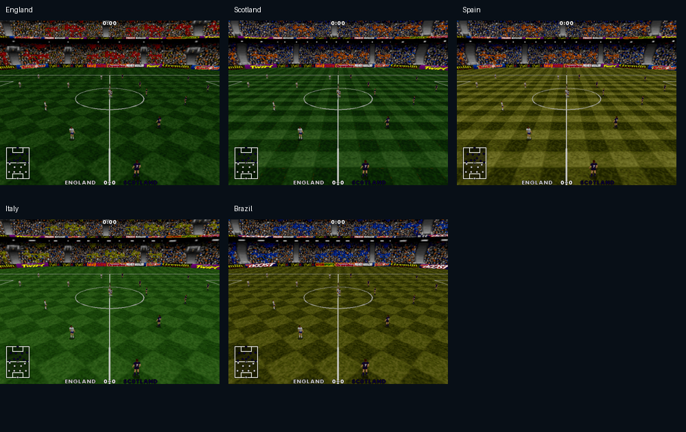
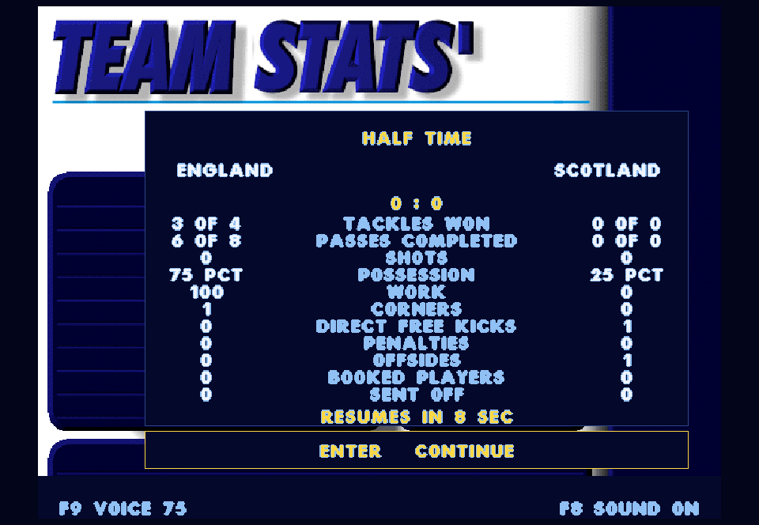

# Original match presentation batch — 0.33.0

Five connected presentation features are reviewed together. Original SOURCE files remain unchanged. This release keeps the existing football simulation and native Windows/SDL boundary.

1. **Five CD venues.** Match setup gains a Venue row: England, Scotland, Spain, Italy and Brazil. Each is a complete high-detail CD descriptor with its own stand meshes, UV table, map pages, pitch and sky, validated against the pinned CD executable and archives. These are the CD's country-labelled venue sets, not invented stadium names or a claim of five different architectural models: several share geometry but use different artwork. Selection applies only on confirming a new match; returning from setup preserves the running venue. England remains the default. Missing optional venue files are skipped.
2. **Original corner flags.** DATA.OBJ flag_p/flag_f and 3DENG.C's four corner placements are restored. The flag artwork is stored in the right-hand portion of the original pitch bitmap, packed onto extra-map page 6 at row 116. Original wind deformation and three texture frames use the simulation clock, not display frequency or gameplay RNG. No wind leaves the original hanging flag pose. This does not turn wind on or alter ball physics.
3. **Original match notices.** Goals, yellow/red cards, offside/free kicks and completed substitutions display the original font and applicable goal/card/whistle sprites from the source's menu functions. Names come from the actual current shirts. A compact translucent native panel replaces the DOS sliding menu buffer. Notices last 100 simulation ticks, freeze on pause and are hidden during replay. They do not pause live play or alter referee decisions. The full original menu geometry, shirt-icon composition and transitions are not claimed.
4. **Expanded match statistics.** Half/full-time panels restore the source statistics categories in a readable native layout. Tackles won/attempted, completed/attempted passes, shots and work derive from the original per-player counters. Outgoing-player totals survive substitutions; side ownership follows original half-time swaps; shootouts freeze the match figures. Corners, direct free kicks, penalties and offsides count actual restart preparation. Booked players/sent off count original booking state. Native live-possession ticks supply possession share, because original tm_posst also contains a dribble-performance bonus and cannot honestly be presented as possession time. The original stat_sheet calculation is absent and its high-resolution draw branch is a placeholder, so the native ratios/layout are not described as recovered original calculations.
5. **Original player-name commentary.** Investigation corrected the proposed country-name feature: AUDIO.OBJ PlayTeamSample selects a player's name from the team bank. The importer now brings in 543 X/Y/Z recordings for 181 exact initial-plus-surname matches within the same country. It verifies the original 33-byte player records, squad-number-plus-one filenames and three intonation selectors. Engine callbacks capture stable team and current shirt identity, so substitutions/end swaps cannot select the old occupant or the opposing country. Unmatched names remain silent; no country-name substitute or synthesized speech is inserted. Names have low native priority and cannot interrupt event commentary; pause/mute/focus handling matches other speech. The native scheduler is not a reproduction of the DOS audio driver. The generated predictor now restores its incoming prediction flag after producing trajectory samples; the original routine leaves that flag set for its DOS caller to manage. This native boundary fix lets real player callbacks through while keeping speculative callbacks silent.

## Combined review

Use the same launcher on your next launch. In match setup, use the arrows or D-pad to select Venue and change it. Confirm through the lineup screen to apply it. Watch one CPU match for corner flags, player-name calls and event notices, then review the expanded half/full-time statistics. No manual asset copying or ZIP extraction is needed.

Evidence: [venue descriptors](cd-venues-recovery.json), [name recordings and matching](cd-names-recovery.json), plus the generated graphics recovery report. Tests cover all five rendered venues, flag animation/pause, event notices, statistics across substitutions/halves/shootouts and player-name identity/priority. The full CPU fixture emitted 46 original name callbacks and played 34 matched name recordings. All 61 CTest checks passed in 166.87 seconds. The CPU reference remains 1:0 at 7,328 ticks. [Full results](presentation-batch33-test-results.txt).

Published snapshot `8d660c36aff86cb5-2b4b128d-0703f4d7-65e2336c` passed launcher/media hash verification, an offscreen 180-tick match capture and the 40-frame front-end smoke test using its published media. Original SOURCE files remain unchanged. No interactive game was restarted.
