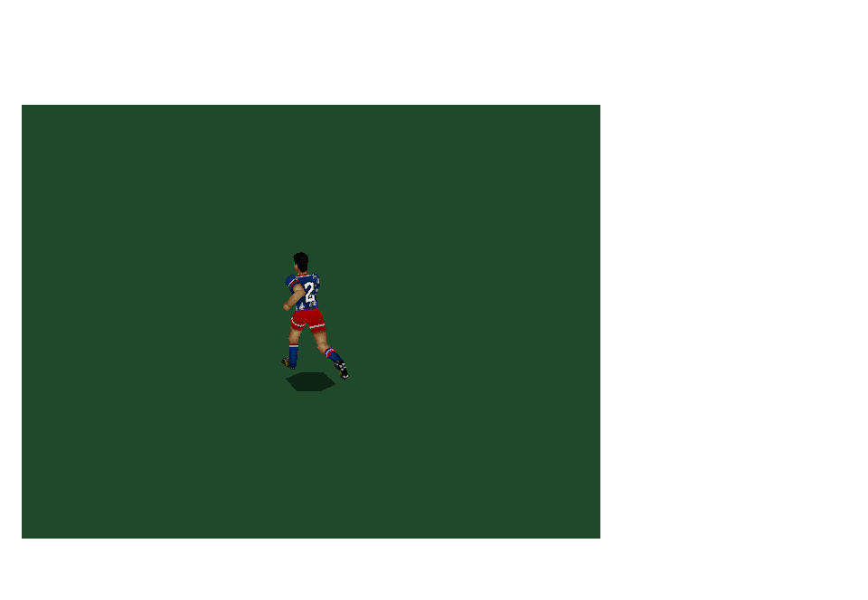

# Shirt-number correction - 0.15.1

User feedback showed a head on a player's back in the animation viewer. The
thirteenth face is the shirt-number panel, but the native renderer had left its
DATA.OBJ default material (a head-atlas entry) unchanged. Original render3d
rebinds face[82] to the selected player's number before drawing.

Both the viewer and action scene now copy the original face table and bind the
correct home/away number. The fixture uses team slots 1-11, including keepers.
Original kit-table number atlases populate page 6 at rows 62 and 89. Away-number
palette remapping preserves the source's encoded-index comparisons. Substitute
numbers 12-15 and full match roster shirt-number selection remain outside scope.

The number atlases are already encoded for polyt: byte 1 is transparent and
other bytes are decremented before palette lookup. This behavior is verified
against the pinned RENDER.OBJ rasterizer instructions. The native page decoder
applies it so numbers sit on the shirt without an opaque white rectangle.
Original render3d material immediates are separately checked in 3DENG.OBJ.
The recovery report includes instruction offsets, bytes and the rasterizer hash.

Regression checks cover all 22 fixture player slots and mirrored material
variants, verify shared mesh data remains unchanged, and render consecutive
home/away numbers from behind for all 16 kit pairings. Close-up screenshots
verify the actual animation viewer, beyond the previous whole-scene checks.
No gameplay, animation timing or SOURCE files changed.

Validation: all 30 CTests passed in 38.39 seconds; source/archive audit passed.
The corrected animation-view close-up was visually inspected after transparency decoding.

---

# Original scene restoration - 0.15.0

This is one five-part graphics batch around the approved original action fixture:

1. Separate home, away and goalkeeper materials, including mirrored captures.
2. Complete pitch markings in the action view: areas, arcs, halfway markings and spots.
3. Both goals with their original net textures, geometry and five distance-based detail entries.
4. Original player and ball shadow meshes, using displayed positions including captured-ball handoffs.
5. Ball rotation driven by the original engine's horizontal/vertical angles and original addobjxy transform.

## Provenance and adapter boundaries

`restore_graphics.py` pins DATA.OBJ and 3DENG.OBJ, resolves the original goal and
player-face pointer tables, and records all five goal-detail entries for each of
the eight goal components. Original `objdepd` and `addobjxy` bodies now compile
natively alongside the nine previously restored graphics bodies and blend excerpt.
No original mesh or texture was drawn anew. SOURCE remains untouched.

Team textures follow init3d's home/away page packing, palette slots and indexed
pixel remapping. The original face table distinguishes teams, goalkeeper slots
1/12, and mirrored poses. Keeper torso/limb and net archive IDs are checked against
exact loader instruction bytes; the away keeper uses extended pages 13 and 14.
The net atlas is original archive record 40 on page 15. The fixture pairs kit N
with N+1 (wrapping at 16); this is a native preview choice, not match team selection.
At this checkpoint, player-specific skin selection and shirt-number composition remained incomplete; the number correction above supersedes that limitation for fixture slots 1-11.

The pitch spots and shadow meshes come from DATA.OBJ. Ground marks and shadows
render before actors; both goal assemblies use the original world locations.
The native SDL backend applies half-strength black and grey alpha for original
filter IDs 256/257, corresponding to makefilter's targets 0 and 48 in the 6-bit
palette. This omits the DOS nearest-palette-color quantization. Near goals use
original textured net faces; distant goals retain the original filter fallback.
General clipping/rasterization and stadium drawing order remain native adapters.

Ball orientation uses new_update_coords' cosine/sine mapping into addobjxy.
The native presentation snapshots interpolate angles over the shortest arc;
rotation and extra renders do not advance the original physics. The previous
0.14.1 capture/physics ball-position fixes remain active.

## Validation

The scene regression renders 16 home/away kit pairings, both goalkeeper materials
and mirrored poses. Pixel comparisons catch accidentally shared or absent material
pages. It checks all five detail thresholds, original ball geometry rotation,
angle wrapping, camera orbits and the complete catch/distribution/reception chain.
The default contacts remain catch 59, distribution 171, reception 208, finish 229.
Captures at the catch, keeper wind-up and final chest control were generated;
wind-up and reception renders were visually inspected. Existing tests also cover
all 4,983 preserved motion frames and the previous ball-continuity regression.

This restores scene presentation. Full original match AI, scoring/restarts,
menu integration and original audio playback remain unfinished. Original sound
still needs DIGI/PITCH/PITCH.MAD from the original game data.

All 30 CTests passed in 50.51 seconds. The source/archive audit passed, and SOURCE has no diff.
