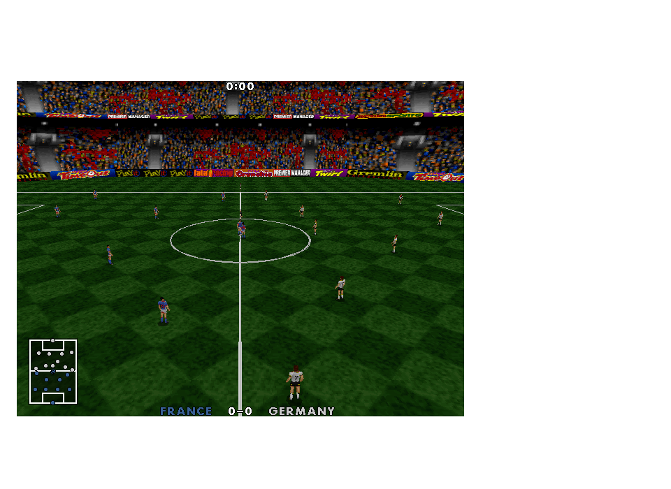
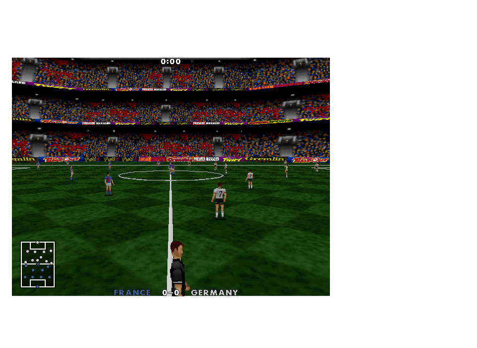
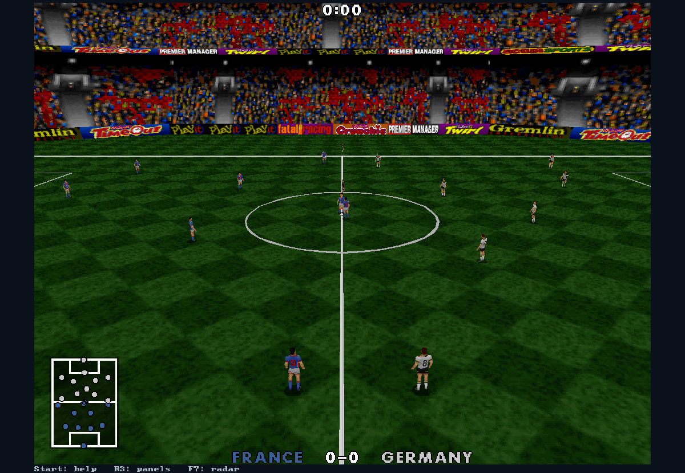

# Matched original CD stadium - 0.31.1

The 0.31 renderer showed a large solid red band between the crowd and roof.
Its Euro archive stand faces reference flat colours 248-250, which are red in
that archive's palette. That observation established where the band came from,
but did not establish that it represented the finished game's intended stadium.
The earlier explanation overstated the evidence.

## Recovery decision

The supplied Actua Soccer CD has a different stadium asset revision. None of
the four Euro stand meshes, their faces, the stadium UV table or its two texture
pages matches a CD record byte for byte. Rather than recolouring those faces or
inventing replacement textures, this release loads the complete high-detail
England stadium shipped on the original CD. This is a change of stadium asset
set, not proof of a single missing texture on the Euro model. It is the 1995
Actua CD stadium, not a claim to have recovered the missing finished Euro 96 art.

## Evidence and reproduction

Run `python tools/import_cd_stadium.py PATH_TO_ISO`. The importer reads the ISO
without executing its contents. All three inputs (SOCCER.EXE, ACTREND.DAT and
ACTREND.OFF) are pinned to their previously verified SHA-256 values.

The executable stadium table starts at file offset 0x132fa4 with 240-byte
records. FILES.C describes three tiers of 45 countries. Index 104 selects the
high-detail tier (90) plus England (14). All four stand positions and the
360/390/820 width/length/height match that source descriptor. The importer also
checks the first table descriptor to establish the table base independently.
The adjacent original sky table supplies the selected cloudy bitmap/palette.

The asset set contains UV record 276, texture pages 112/122, four point/face
pairs (284/283, 280/279, 278/277, 282/281), pitch bitmap/palette 247/202 and
sky bitmap/palette 226/220. It retains every component byte unchanged in an
optional local-data/GRAPHICS/STADIUM.BIN. See [hashes and descriptor evidence](cd-stadium-recovery.json).

The native reader validates sizes, geometry counts, finite coordinates, face
indices, material ranges, texture-page identity and palette channels before
replacing the active scene. Stadium bounds, stand positions, UVs, texture pages,
ground and sky update together. Original engine simulation is unchanged. The
source Euro stadium remains the fallback when CD media is unavailable. Pitch
mesh dimensions are now owned per graphics instance so imported bounds do not
mutate another renderer's scene. Animated video-board playback remains pending.

## Verification

The environment test first reproduces more than 5,000 red pixels in the upper
portion of the old stadium camera. It then loads the CD scene and requires that
red region to drop below one fifth, checking completed SDL frames. It also
captures both the automatic and follow-ball views for visual review, renders all
sixteen country pairs in all three cameras, and completes the CPU match with the
same expected 1:0 score in 7,328 ticks. Source archives remain unchanged.

Final build, regression and publication results are recorded in
stadium-test-results.txt. No interactive game is restarted by publication.

All 58 regression checks passed (187.50 seconds). The published snapshot passed
hidden capture/front-end smoke and launcher media verification.

