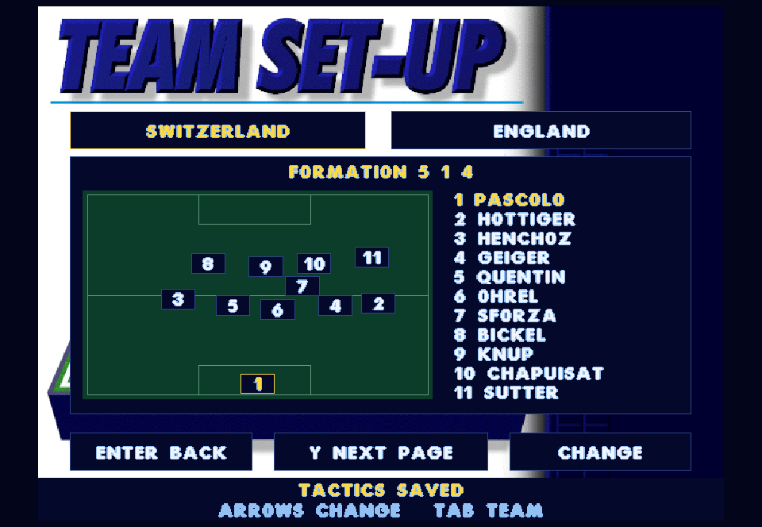
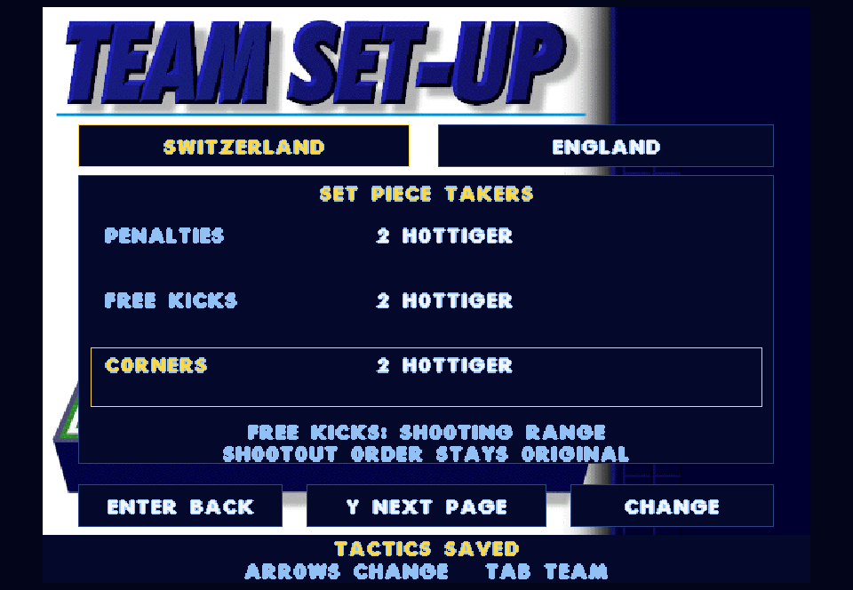
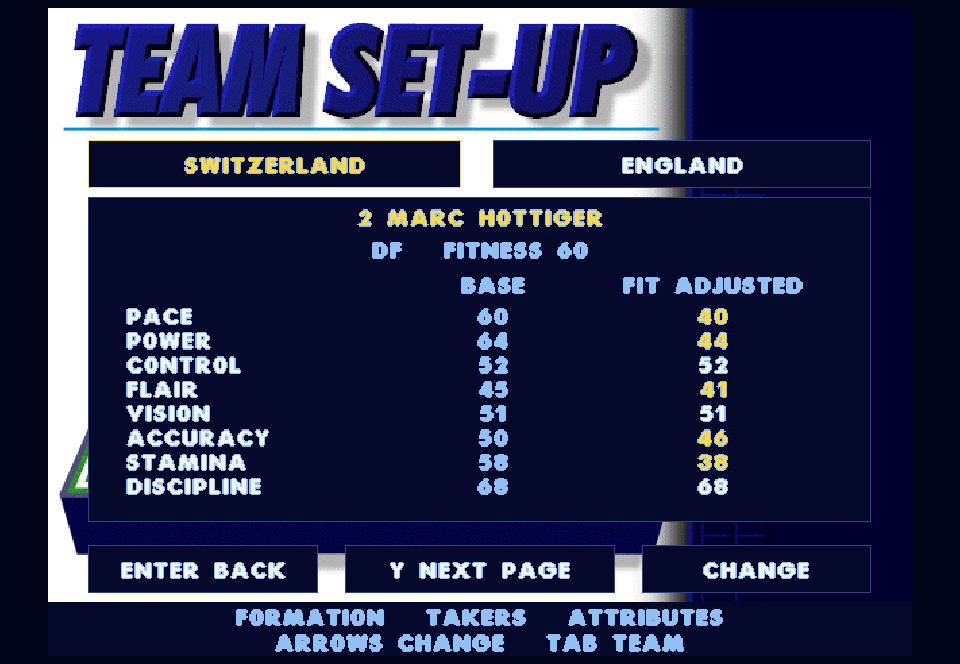

# Tactics and match management - 0.36.0

This five-feature batch adds saved country formations, a player-position diagram, half-time formation changes, preferred set-piece takers and original player attributes.

## Trying the batch

Use the existing Play-Actua96 launcher when ready. On the pre-match lineup or half-time screen, press **T / West** (Xbox X) to open tactics. **Y / North** cycles Formation, Set Piece Takers and Attributes. **Tab / LB / RB** switches countries. Your opponent is view-only when you are playing; Watch All allows both countries.

- Formation: Left/Right selects one of the ten original formations. Up/Down highlights a player in the eleven and on the pitch diagram.
- Set Piece Takers: Up/Down chooses penalties, free kicks or corners; Left/Right chooses Automatic or an eligible outfield player in the current eleven.
- Attributes: arrows browse all 20 squad members. The panel shows the original eight ratings, current stored fitness, and the same fitness-adjusted values used when applying match ratings. It is not a live stamina meter.
- Enter / South, T / West or Esc / East returns to the lineup or interval screen. Confirm again to kick off or resume. Half-time editing keeps the match paused, including CPU matches.
- Mouse: click the tactics footer to open, country tabs to switch, and the bottom Page/Change/Back buttons to navigate. The left/right halves of the formation title, taker rows and attribute name select previous/next; click the formation's player list to highlight a player.

Tournament choices save immediately by country, including half-time edits. Exhibition choices apply to the pending/current match. At half-time the diagram lists the actual eleven after substitutions and marks dismissed players OFF.

## Original engine and native interface

The ten formations and all 70 ball-zone tables come from EURO.DAT entries 111-120. The diagram uses the original neutral zone 20; the match receives all zones and continues to use the original tactical movement. Formation names are recovered from SCRIPT.96. Half-time changes replace the active table without reinitializing the score, clock, player statistics or match.

The original RULES routines already contain penalty_taker_a/b, fkick_taker_a/b and corn_kicker_a/b. The native adapter resolves a saved shirt number to its current on-pitch slot, including after substitutions and changes of ends. A substitute does not inherit another player's preference. Unavailable selections fall back to an eligible player through the original taker selection. Automatic retains the engine's normal selection. Direct free kicks honour the preference in shooting range; the original long-range nearest-player policy and indirect free-kick selection remain in place. Shootouts keep the original rotation.

Player identities and eight ratings come from the original roster. EURO_INF's fitness deductions are shared by the attribute panel and match initialization. The diagrams, navigation, persistence and identity mapping are native restoration code; this is not a claim that the DOS menus had this exact layout. SOURCE remains unchanged.

## Save compatibility

Save version 3 extends the existing checksummed, atomically replaced tournament checkpoint with a formation and three preferred shirt numbers for each of the 16 countries. Version 1 and 2 saves remain loadable; absent tactics initialize to each country's original formation and Automatic takers. Existing scores, and version 2 player condition/squads, are preserved. Invalid formation/taker values are rejected before replacing the current state. Saves continue to use the per-user AppData location.

## Verification

All 65 regression checks passed in 171.73 seconds. The tactics contracts cover all ten complete 70-zone tables, country/end mapping, awarded penalties/direct free kicks/corners, unchanged indirect free-kick selection, substitution and dismissal fallback, save version 2 migration, invalid checksummed preferences, shared attribute calculations, keyboard/gamepad/mouse navigation and half-time state preservation. The full original-engine 31-match CPU tournament used non-default formations and preferred takers for every country, saving and reloading between fixtures; it completed with Germany as champion, four extra-time matches and three shootouts. Formation, taker, attribute and half-time renders were visually reviewed.

Published version 0.36.0, snapshot `be7d20c134b1577b-2b4b128d-0703f4d7-65e2336c`, passed executable/media hash verification. The exact published executable passed the hidden AppData probe for creation, simulation, atomic replacement, backup, reload, resume and next-fixture launch. The user's existing tournament save had the same SHA256 before and after. The running interactive game was not restarted. The original SOURCE tree is unchanged.

[Full regression results](tactics-regression.txt) and [published save probe](tactics-published.txt).

