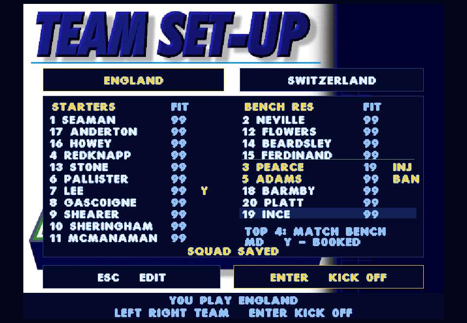

# Tournament continuity - 0.35.0

This batch connects player fitness and fatigue, injury persistence, accumulated yellow cards, suspensions, and pre-match squad selection to the saved Euro tournament.

## Trying the batch

Reopen the existing Play-Actua96 launcher when ready. Resume with L / R3; existing 0.34 saves still load. Before your next match the lineup screen shows all 20 players. Up/Down selects a player; Space / North picks him, then selects a second player to swap. Left/Right switches countries. Mouse clicks also pick and swap players. Enter / South kicks off. Only your selected country's squad is editable; Watch All allows either country.

The left column is the starting eleven. The first four players in the right column are the match bench; the remaining five are reserves. Squad choices save immediately, including changes to the match bench. Fitness, a pending yellow (Y), injuries (INJ) and a one-fixture suspension (BAN) appear alongside names. The selected player's position appears below the reserves. The starting goalkeeper must be a goalkeeper. Injured or suspended players cannot enter the starting eleven or match bench. The in-match substitution panel uses your selected bench and the existing three-change limit.

## Preserved code and native additions

- SCRIPT.96 supplies each player's starting fitness and original ratings. EURO_INF's fitness deductions (50% of missing fitness from pace/power/stamina and 10% from accuracy/flair) now feed the engine; ratings are bounded before FOOTBALL's +28 conversion. This is a native connection of the frontend's displayed adjustments to the match ratings.
- FOOTBALL.player_stamina still supplies per-match fatigue using actual playing time. Substitutes start their own playing clock; injured players enter with reduced ratings. We do not invent persistent fatigue loss from match minutes: the source fatigue curve resets for each match.
- RULES.inc_inj and EURO_MAT's injury deduction/minimum fitness of 10 supply injury accounting. The source contains no inc_inj caller. A native tournament-only trigger on INTELL.player_ints' original opposing crunching-tackle branch uses `(seed & 31) == 0`, adding `20 + seed / 2` injury points to the victim. It consumes no additional random draw. Existing exhibition behavior is unchanged. Injuries affect subsequent matches; this batch does not add forced mid-match medical substitutions.
- RULES bookings retain their original encoding: yellow +1, red +5 (second-yellow dismissal is 6). EURO_SQD uses disciplinary points above one and fitness below 25 to exclude players. The native ledger carries one outstanding yellow across fixtures; another yellow or a dismissal earns a one-match ban and clears the pending yellows.
- The preserved source does not implement ban service or a complete recovery calendar. Native scheduling serves a ban only after that country's next completed fixture, and restores up to ten fitness points per completed country fixture before subtracting fresh injuries, capped at that player's original fitness. Skipped fixtures are real CPU matches. Other countries' games, cancelled games and menu visits do not heal players or serve bans. These are restoration policies, not a claim about historical Euro regulations.
- EURO_SQD's unavailable-player replacement principle is retained. The native adapter checks the whole match squad, prefers matching positions and retains an eligible goalkeeper. Squad order is distinct from permanent player identity and shirt number. Country identity survives native home/away mapping, half-time end changes, substitutions and penalties.

## Persistence and boundaries

Version 2 saves keep all 320 players' fitness, pending yellow, remaining ban and each country's 20-player squad permutation alongside the existing result ledger. They use the same per-user AppData location, checksum, atomic replacement and preceding-checkpoint backup. Loading checks bounds, unique membership and goalkeeper identity before replacing live state. Version 1 saves preserve all match results and initialize missing player history from the original roster; earlier injuries/cards cannot be reconstructed from scores alone.

All condition changes commit only with a finished fixture. The existing match engine still makes tactical and football decisions. There is no new transfer system, historical real-world ruleset or DOS-save compatibility. The preserved SOURCE directory is unchanged.

## Verification

All 64 regression checks passed in 186.41 seconds. Final position-aware replacement and layout changes then passed all six affected tournament/frontend/presentation/save checks in 5.16 seconds, including another full 31-match original-engine CPU competition. Additional complete keyboard/gamepad/mouse selection, persistence and kickoff checks passed after the final test fixture update. The original SOURCE tree is unchanged.

The continuity contracts exercise fitness-adjusted pace plus original fatigue, a live crunching-tackle injury, a previously booked player substituted before full time, end-swapped country mapping, injury/ban exclusion, bans not served by other countries or cancellations, service and recovery after the next own fixture, reserve selection into the match bench, direct reds, exhibition reset, v1 migration and checksummed duplicate-player rejection. The rendered lineup was visually checked for readable full surnames, fitness and disciplinary status.

Published version 0.35.0, snapshot `1ca5b793997401b2-2b4b128d-0703f4d7-65e2336c`, passed launcher/media hash verification. The exact published executable passed the hidden AppData probe for creation, simulation, atomic replacement, backup, reload, resume and next-fixture launch. The real user's existing save hash was identical before and after; the interactive game was not restarted.

[64-check regression](tournament-continuity-regression.txt), [final affected checks](tournament-continuity-final-checks.txt), [control checks](tournament-continuity-controls.txt), [published executable save check](tournament-continuity-published.txt).

