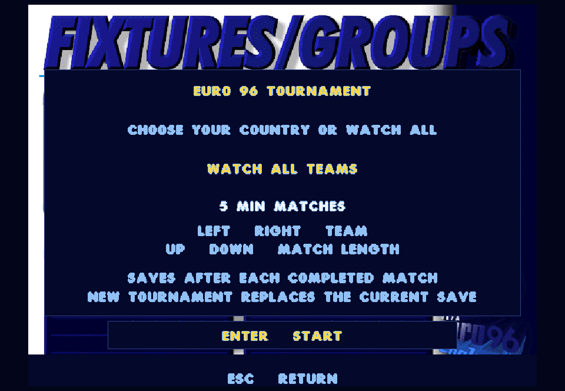
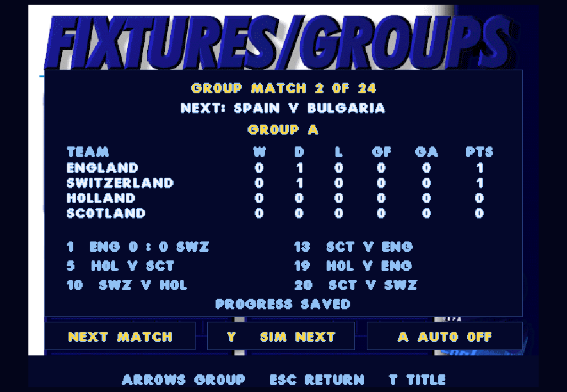
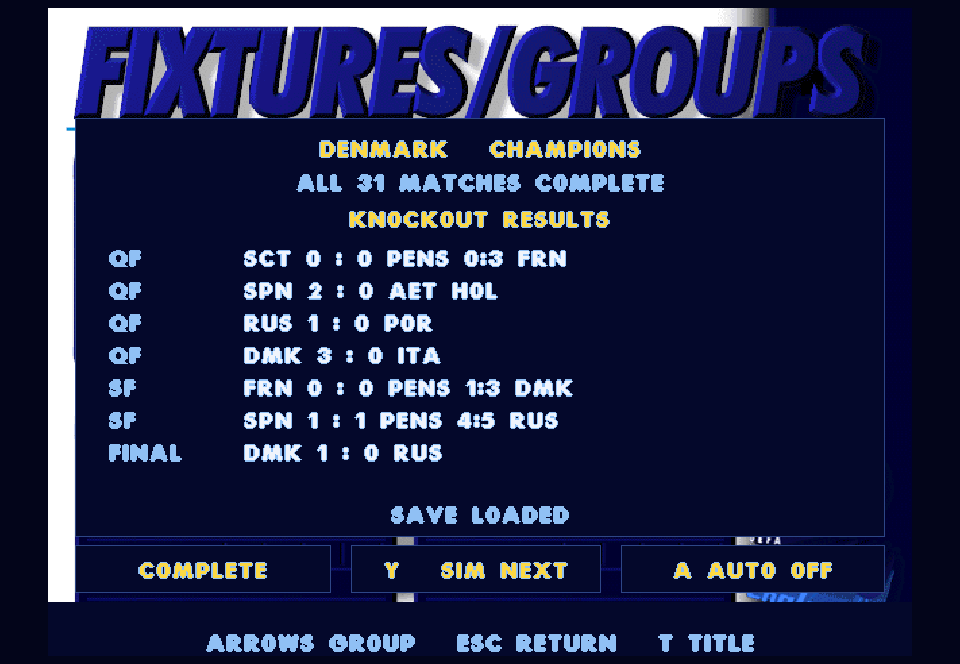

# Euro tournament restoration - 0.34.1

Five connected features: country/spectator entry, original group fixtures, group standings, knockout progression, and saving/resuming between matches. The original SOURCE tree remains unchanged.

## Playing the batch

Use the same launcher. On the title screen, **T / West** opens a new tournament; **L / R3** loads the saved one. Enter/South still opens exhibition match setup.

Select Watch All Teams or a country with Left/Right/D-pad. Up/Down changes match length. Enter/South starts the competition and creates its checkpoint. A new tournament replaces the current save, with the preceding checkpoint retained as a backup.

The tournament screen shows four group pages and a knockout page. Left/Right cycles pages. Enter/South starts the next fixture; when playing a country, other countries' matches are simulated through the restored engine. Y/North simulates one spectator fixture. A/R3 toggles automatic progression: spectator matches play onscreen, other-country fixtures simulate, and your own lineup waits for confirmation. Escape/Back cancels a background simulation without recording a score.

During a match, F2/L3 opens the tournament screen and pauses play; Enter or Escape returns to the same match. T/West on that screen returns to the title. Unfinished matches are restarted when loading the saved competition. Saves represent completed fixtures, not mid-match snapshots. Debug/practice/rematch/team-takeover shortcuts are blocked within tournament matches to protect fixture identity. Pause, replay, camera, squad and normal playing controls remain available.

Progress saves automatically after each completed match in SDL's per-user application folder: `%APPDATA%/Actua96 Restoration/Actua96/tournament.sav` on Windows, outside protected Documents and versioned playtest builds. When there is no new-location save, Resume can load a valid legacy `user-data/tournament.sav` beside the source and copy it into the new location; the old file remains untouched. A failed save is shown onscreen and blocks the next match; S/LB retries. Corrupt saves do not replace valid in-memory state. The previous file is retained as `tournament.sav.bak`. These are native versioned files, not DOS save compatibility.

## Original code and native boundaries

- `tools/restore_tournament.py` extracts all 31 fixture slot pairs from EURO_VAR.CPP, slot numbers from EURO_DEF.H, and the default country draw from SCRIPT.96. The first match is England/Switzerland. Each group plays six matches; qualifiers use the original quarter-final pairings and semifinal winner slots (QF1/QF4, QF2/QF3).
- EURO_FIX.CalculateLeagueTables is compiled from its preserved body, removing only diagnostic printing and rebinding its arrays. Ranking follows this build's points, wins, then goal difference. Fully equal teams retain their original draw order. This is the game's algorithm, not a claim to implement every real-world UEFA tiebreaker.
- Group points use the preserved TEST.CPP defaults of three for a win and one for a draw. EURO_MAT's goal assignments overwrite previous totals; the native result ledger deliberately accumulates them. Group tables remain frozen during knockout rounds.
- Every played or skipped fixture uses the existing restored match engine. Knockout matches use its extra-time and penalty flow. No random score generator or forced tournament winner is added. The automated test's results are outcomes of this restored simulation, not historical Euro 96 results.
- The existing native human controller owns the home slot. If the selected country is scheduled away, the match adapter places that country in the controllable slot and maps goals/penalties back to the original fixture order afterward. The tournament ledger retains the source fixture order. This does not add a second human controller.
- Original fixture artwork and fonts frame native navigation, tables and result panels. The existing selected CD venue/camera are retained; this does not claim venue-specific English city stadium assets. In 0.34, the source tournament redraw animation, per-player discipline/injury carryover and DOS save format were outside the batch. Version 0.35 adds [player continuity and squad selection](TOURNAMENT-CONTINUITY.md); redraw and DOS saves remain outside its scope.
- EURO_DSK's save format omits the full results and knockout winners. Native saves use an explicit schema and checksum, bounded parsing, reconstruction/validation through fixture rules, a temporary file and atomic replacement. Tables and bracket are derived from validated results instead of accepting arbitrary saved standings.

## Verification

The new test runs all 31 matches to completion, saves/reloads after each, validates every group pairing, cumulative goals, original ranking order, knockout winner routing, extra-time and penalties, human away-country mapping, cancelled simulations, automatic continuation, malformed saves, write failures and keyboard/gamepad navigation. Rendered entry, tables and champion screens are visually reviewed. All 62 regression checks passed in 203.10 seconds. The final shortcut guards then passed all five affected tournament/front-end/commentary/presentation checks in 18.13 seconds. The full CPU competition finished with Denmark as champion, four extra-time matches and three shootouts, with a save/reload after each fixture. [Full suite](tournament-test-results.txt), [final checks](tournament-final-test-results.txt), [competition log](tournament-validation-log.txt), [source evidence](tournament-recovery.json).

Published snapshot `24fed701d5a0e0a4-2b4b128d-0703f4d7-65e2336c` passed launcher/media hash verification, an offscreen title capture and the 40-frame front-end smoke test. No interactive game was restarted.

## Save-location fix (0.34.1)

The user's Windows Defender event 1123 confirmed that Controlled Folder Access blocked actua96.exe from modifying Documents. Version 0.34.0 incorrectly placed its native saves there. Temporary-directory tests passed while the real installed game could not create its save folder. No security setting or allowlist was changed.

The default path now comes from SDL_GetPrefPath. Save/load errors log their actual path and exception. A new `--tournament-save-smoke` check runs inside actua96.exe and creates an isolated probe beside the real save, simulates one original CPU fixture, checks atomic replacement and backup, reloads via the frontend, and starts the next match. Probe files are removed afterward and the user's checkpoint is never overwritten. The check requires its success marker, not only exit code zero.

Version 0.34.1 passed all five affected checks (tournament contracts, frontend contracts, presentation contracts, frontend smoke and production save-directory smoke) in 3.58 seconds. This is an affected-check run; the 62-check full-suite result above belongs to 0.34.0. [Save fix checks](tournament-save-fix-tests.txt).

Published snapshot `665d108b7e5884a7-2b4b128d-0703f4d7-65e2336c` passed launcher/media hash verification. Its exact published executable then passed the hidden save-directory diagnostic in Windows AppData: create, simulate, replace, backup, reload, resume and next fixture. The actual tournament save was absent before and after this isolated probe. No interactive game was restarted. [Published executable check](tournament-save-published-check.txt).
